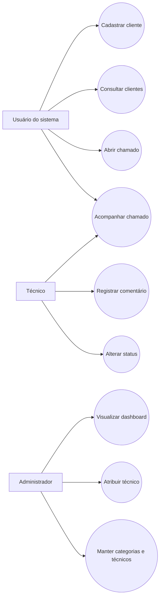
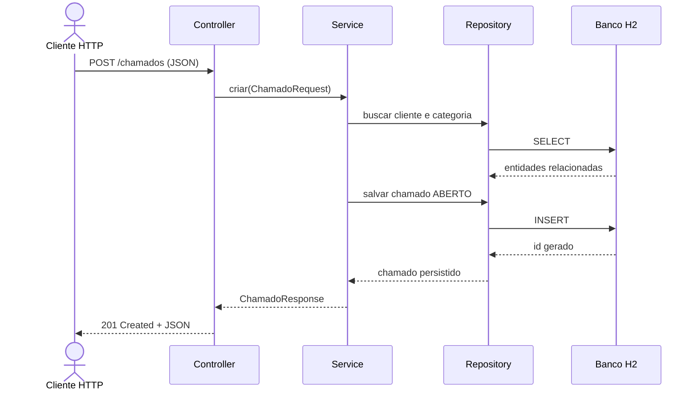
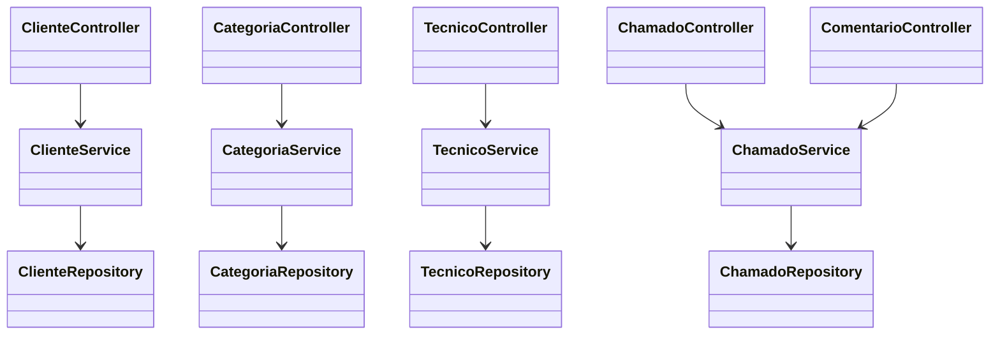
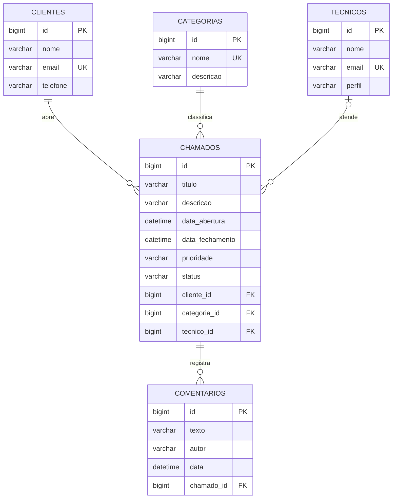
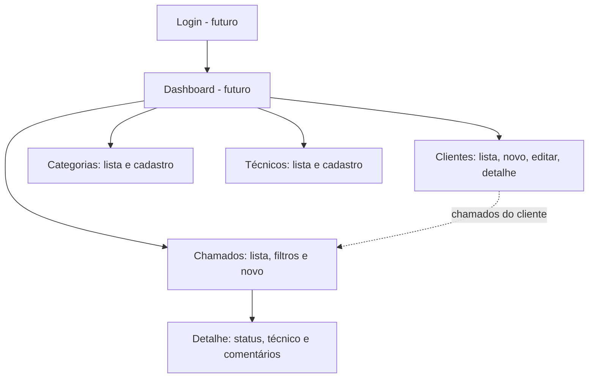

# Arquitetura e domínio

O código está em `br.com.sistemas.chamados`, com pacotes `controller`, `dto`, `entity`, `exception`, `repository` e `service`. Controllers traduzem HTTP, Services aplicam regras e transações, Repositories encapsulam JPA, Entities representam persistência e DTOs definem o contrato JSON.

## Casos de uso

## Sequência: abertura de chamado

## Classes e camadas

## Entidade-relacionamento

## Mapa de telas planejado

O mapa de telas descreve uma evolução futura; esta entrega implementa a API REST, autenticação HTTP Basic, documentação OpenAPI e endpoint de dashboard, sem interface web.
